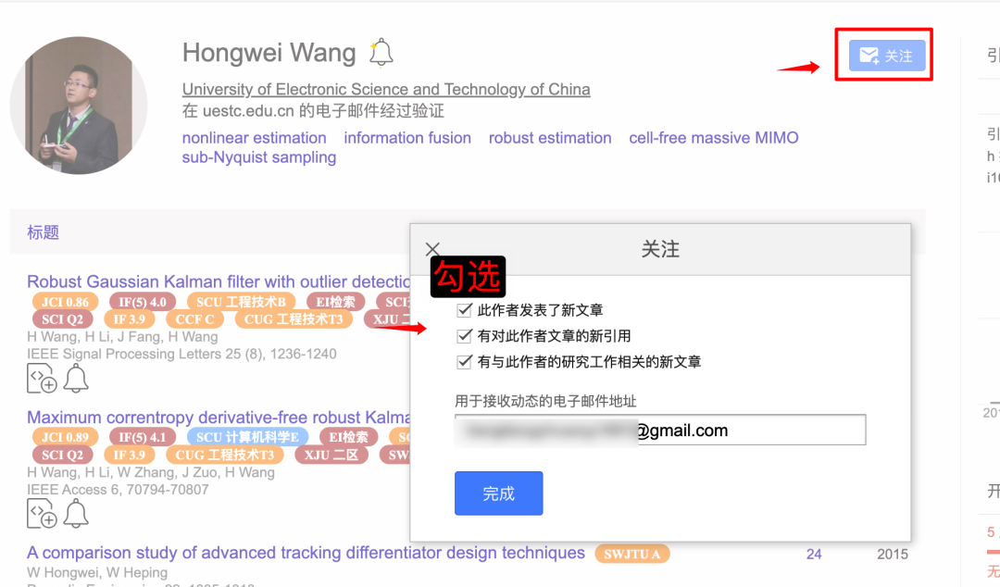
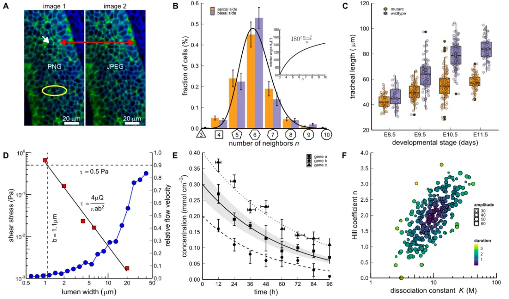
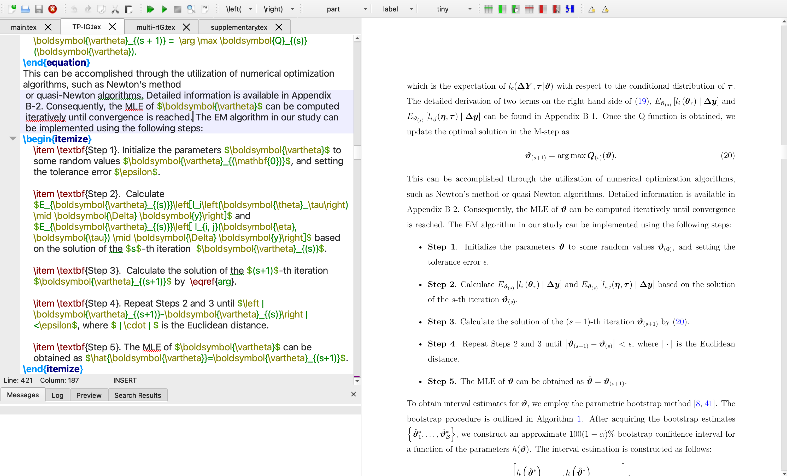
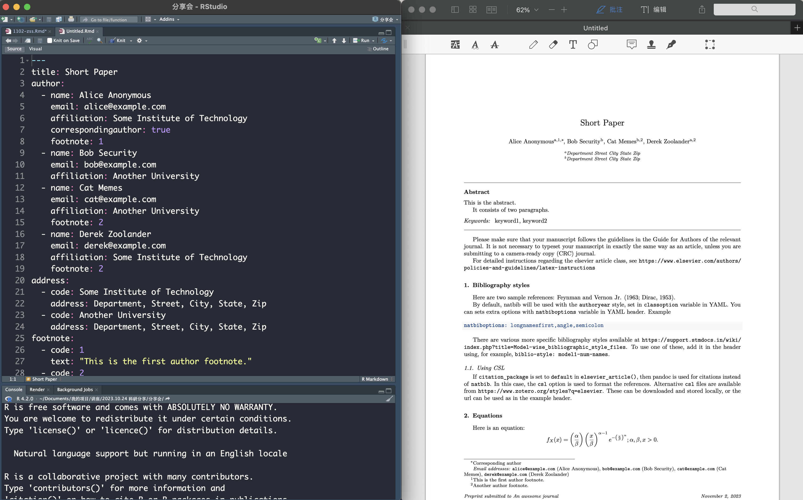

```{r setup, include=FALSE}
options(htmltools.dir.version = FALSE)
knitr::opts_chunk$set(echo = FALSE, message = FALSE, warning = FALSE, cache = FALSE)
```

class: overview

## 怎样把一项研究推进到完成？

<div class="research-map" aria-label="确定方向、文献检索、阅读与管理、研究问题、研究实施、论文表达、投稿修改，反复迭代">
<svg class="feedback-edge" viewBox="0 0 1062 316" aria-hidden="true"><defs><marker id="back-arrow" markerWidth="8" markerHeight="8" refX="4" refY="4" orient="auto"><path d="M0,0 L8,4 L0,8" fill="none" stroke="#23395b" stroke-width="1.4"/></marker></defs><path d="M276,252 H117 V138" fill="none" stroke="#718eaf" stroke-width="2" stroke-dasharray="7 5" marker-end="url(#back-arrow)"/></svg>
<div class="stage s1"><span>01</span><strong>确定方向</strong><small>导师课题 · 实际问题</small></div>
<div class="stage s2"><span>02</span><strong>文献检索</strong><small>关键词 · 引用关系</small></div>
<div class="stage s3"><span>03</span><strong>阅读与管理</strong><small>精读 · 笔记 · 文献库</small></div>
<div class="stage s4"><span>04</span><strong>研究问题</strong><small>已有不足 · 可行切口</small></div>
<div class="stage s7"><span>07</span><strong>投稿修改</strong><small>期刊要求 · 审稿回复</small></div>
<div class="stage s6"><span>06</span><strong>论文表达</strong><small>图表 · 公式 · 写作</small></div>
<div class="stage s5"><span>05</span><strong>研究实施</strong><small>复现 · 拓展 · 验证</small></div>
<div class="feedback">↶ 结果与预期不符：回查文献、假设与研究问题</div>
</div>

<div class="page-note">科研是反复迭代的：每一步都留下可检查的记录，返修也可能回到研究实施。</div>

???
约 1.5 分钟。沿蛇形箭头读七个阶段，强调研究问题可以在阅读、复现和实验中逐渐变化。反馈关系不是机械走完一次流程；不支持预期的结果也要记录。
---

class: direction

## 怎样从一个宽泛方向找到切入点？

<div class="three-flow">
<div class="step"><span>起点</span><strong>导师课题／研究领域</strong><p>了解任务与已有资源<br>从实际问题出发</p></div>
<div class="step"><span>阅读</span><strong>核心文献与已有方法</strong><p>先读综述，再读核心论文<br>梳理问题、方法与不足</p></div>
<div class="step"><span>收窄</span><strong>具体研究问题</strong><p>明确研究对象与条件<br>与导师讨论是否值得做</p></div>
</div>

<div class="example-band"><span class="eyebrow">方向收窄示例</span><p>可靠性统计 → 寿命数据 → 右删失数据 → <strong>指定时点可靠度的估计与区间</strong></p></div>

<div class="page-note"><strong>AI 辅助：</strong>整理资料、梳理主题与待查术语；回原文核对，最后留下“一页方向说明”。</div>

???
约 1.5 分钟。示例是假设的选题路径，不是已经确认的研究空白。右删失指试验结束时部分产品尚未失效。让 AI 依据提供的综述整理关系并保留来源；不依赖凭记忆补造的文献。
---

class: search

## 怎样检索经典文献和最新工作？

<div class="search-layout">
<div>
<h3>① 拆关键词，再组合检索</h3>
<p>对象：<code>reliability</code>／<code>lifetime</code><br>数据：<code>right censoring</code>／<code>censored data</code><br>方法：<code>Bayesian estimation</code></p>
<p><a href="https://scholar.google.com/">Google Scholar</a></p>
<div class="query">"reliability" "right censoring" Bayesian</div>
<p><a href="https://www.webofscience.com/">Web of Science</a> · 主题检索</p>
<div class="query">TS=(reliability AND ("right censoring" OR "censored data") AND Bayesian)</div>
</div>
<div>
<h3>② 兼顾经典与最新</h3>
<p><strong>经典：</strong>从综述追溯关键原文<br><strong>最新：</strong>按年份筛选，检查正式发表版本</p>
<h3>③ 沿引用关系扩展</h3>
<p>先看 References，再点 Cited by；<br>用 <a href="https://www.connectedpapers.com/">Connected Papers</a>／<a href="https://www.researchrabbit.ai/">ResearchRabbit</a><br>从一篇种子论文探索相关工作。</p>
<div class="quiet-block"><strong>AI：</strong>补充同义词与宽／窄检索式。<br><strong>自己做：</strong>抽查前 20 条相关性，再改词。</div>
</div>
</div>

<div class="page-note">记录检索式与日期；用 DOI／出版社页面核对题名和版本。相关图谱不等于直接引用。</div>

???
约 2 分钟。Scholar 不照搬 WoS 的 TS 语法。结果太少去掉方法词，太杂则限定对象或数据条件；高被引不等于必读经典。官网帮助：https://scholar.google.com/intl/en/scholar/help.html 。WoS 可能需要机构权限。
---

class: tracking

## 怎样持续追踪，并留下阅读线索？

<div class="mini-flow"><b>持续追踪</b><i>→</i><b>筛选文献</b><i>→</i><b>导入文献库</b><i>→</i><b>留下阅读线索</b></div>

<div class="tracking-layout">
<figure><figcaption>作者主页 → Follow／关注 → 选择提醒 → 填邮箱；旧版截图，界面以当前版本为准</figcaption></figure>
<div>
<h3>三种追踪入口</h3>
<p><strong>主题：</strong><a href="https://scholar.google.com/intl/en/scholar/help.html#alerts">Scholar Alerts</a><br>检索后创建提醒</p>
<p><strong>作者：</strong>作者主页 + Follow<br>关注新文章与新引用</p>
<p><strong>期刊：</strong>官网目录提醒<br>邮件或 RSS，每周集中筛选</p>
<div class="quiet-block"><a href="https://endnote.com/">EndNote</a>／<a href="https://www.zotero.org/">Zotero</a><br>导入 RIS／BibTeX → 去重、关联 PDF<br>笔记留：为何读 + 原文位置</div>
</div>
</div>

???
约 1.5 分钟。演示截图里的 Follow、提醒选项和邮件。正文只放一张真正可讲解的操作图。作者名只是原报告界面素材。AI 可汇总本周筛选的摘要与来源，但不能替代精读。我的“文献雷达”用于持续追踪与定期汇总，后半场展开。
---

class: reading

## 怎样精读论文，并形成自己的问题？

<div class="five-points">
<div><span>01</span><strong>研究问题</strong><p>解决什么？<br>对象与目标是什么？</p></div>
<div><span>02</span><strong>模型假设</strong><p>依赖哪些条件？<br>与目标数据吻合吗？</p></div>
<div><span>03</span><strong>方法</strong><p>关键步骤是什么？<br>为何这样设计？</p></div>
<div><span>04</span><strong>结果证据</strong><p>证据支持什么？<br>验证范围有多大？</p></div>
<div><span>05</span><strong>贡献与局限</strong><p>比已有工作好在哪？<br>哪些问题仍未解决？</p></div>
</div>

<div class="reading-flow"><b>读懂一篇</b><i>→</i><b>比较几篇</b><i>→</i><b>候选问题</b><i>→</i><b>进一步检查</b></div>

<div class="evidence"><strong>AI 可提取与比较，但每条都留页码／公式号。</strong><p>原文结论 + 来源位置　｜　AI 分析 + 待核实　｜　自己的判断 + 验证计划</p></div>

???
约 2.5 分钟。每篇论文做一张证据卡。先读摘要、引言、结论，判断关联，再看模型、推导和实验。比较 2–3 篇时，对齐这五个维度；提出候选问题后，重新检索、推导或实验。AI 找不到原文依据时标“未报告”，不能把分析写成论文结论。
---

class: implementation

## 怎样在已有工作上开展自己的研究？

<div class="four-flow">
<div class="step"><span>01</span><strong>精读与复现</strong><p>选 2–3 篇高度相关论文<br>理解推导与代码<br>复现主要结果</p></div>
<div class="step"><span>02</span><strong>真正看懂模型</strong><p>研究问题与关键假设<br>方法逻辑与实验设置<br>适用范围与局限</p></div>
<div class="step"><span>03</span><strong>逐步拓展</strong><p>先做小而明确的改进<br>说清“改了什么”<br>再逐渐增加研究内容</p></div>
<div class="step"><span>04</span><strong>验证与修改</strong><p>理论分析<br>基准比较与数值实验<br>检查结果，反复修正</p></div>
</div>

<p class="ai-label"><a href="https://openai.com/codex/">Codex</a> 等 AI 如何参与</p>
<div class="ai-flow"><span>论文与代码输入</span><i>→</i><span>AI 协助复现</span><i>→</i><span>人工核对与理解</span><i>→</i><span>提出改进</span><i>→</i><span>AI 协助实现</span><i>→</i><span>验证结果</span></div>

<div class="version-note"><strong>版本控制与备份：Git／<a href="https://github.com/">GitHub</a></strong><br>及时提交，写明关键修改与实验结果；代码、数据和环境配置还要安排独立备份。</div>

???
约 2.5 分钟，重点页。先精读复现高度相关的论文，不要一开始就造复杂模型。理解不能只看程序运行成功；要能解释问题、假设、方法、实验与局限。小步改进也需要理论或实验支持。AI 提供解释和实现，研究者核对；用 git commit 记录能解释的修改，远端仓库不能代替全部数据与环境的备份。
---

class: plotting

## 怎样把参考图转化为自己的科研图？

<div class="plain-flow">参考图与审美标准 <i>→</i> 明确绘图要求 <i>→</i> AI 辅助实现 <i>→</i> 人工检查</div>

<div class="plot-layout">
<figure><figcaption>放大看：配色、线宽、字号、图例与子图布局 · <a href="https://github.com/macromeer/scifig_plot_examples_R">原示例代码</a></figcaption></figure>
<div>
<h3>给 AI 的信息</h3>
<ul><li>原始数据 + 变量含义</li><li>参考图／目标图形类型</li><li>配色、线宽、字号、尺寸<br>图例位置、子图布局</li><li>这次具体要改哪一处</li></ul>
<p><strong>给清楚视觉要求，生成可编辑代码，再逐步修改。</strong></p>
<p><a href="https://ggplot2.tidyverse.org/">ggplot2</a>／<a href="https://matplotlib.org/">Matplotlib</a></p>
</div>
</div>

<div class="page-note">研究者验图：数值、单位、坐标与误差条是否准确？不能为了好看改变数据或结论。</div>

???
约 1.5 分钟。原报告的参考图并非本人的可靠性研究结果。先指着图片说明想保留的视觉标准，再告诉 AI 数据与要改的细节，不必逐句教它代码语法。输出保留 R/Python 脚本与可编辑矢量文件；人工对照结果表抽查。iris 散点演示仍保存在 ggplot案例.R 和 figure/16.jpg。
---

class: writing

## 怎样选择论文与研究报告的写作工具？

<div class="writing-layout">
<div class="writing-copy">
<section><h3>LaTeX／<a href="https://www.overleaf.com/">Overleaf</a></h3><p>论文排版与数学公式<br>交叉引用与参考文献<br>期刊模板</p></section>
<section><h3><a href="https://rmarkdown.rstudio.com/">R Markdown</a>／<a href="https://quarto.org/">Quarto</a></h3><p>代码、图表、结果与报告结合<br>修改分析后，可重复生成文档</p></section>
</div>
<div class="writing-examples">
<figure><a href="figure/9.jpg" target="_blank"></a><figcaption>LaTeX：源码与公式排版结果 · 点击看原图</figcaption></figure>
<figure><a href="figure/10.jpg" target="_blank"></a><figcaption>R Markdown：RStudio 源码与文档输出 · 点击看原图</figcaption></figure>
</div>
</div>

???
约 1.5 分钟。此页只讲工具用途。右上指公式与交叉引用的源码／输出，右下指 R Markdown 文件头、正文与生成的论文。区别是各自适合的工作方式，不是互相完全替代。本报告依旧使用 xaringan。
---

class: submission

## 怎样做投稿前检查与模拟评审？

<div class="submission-layout">
<div>
<h3>投稿前：对照期刊官网</h3>
<ul><li>研究范围、文章类型与作者指南</li><li>字数、匿名要求、图表格式<br>数据／代码声明及 AI 使用要求</li><li>数字、公式、引用与结果一致<br>作者信息和文件完整</li></ul>
<div class="quiet-block">检查依据：<strong>目标期刊当前指南</strong><br>不是旧模板，也不是 AI 的记忆。</div>
</div>
<div class="review-example">
<h3>AI 辅助模拟期刊审稿</h3>
<p class="journal-target">目标：IISE Transactions 或<br>Reliability Engineering &amp; System Safety</p>
<p><strong>先核查：</strong>期刊范围、文章类型与投稿要求。</p>
<p><strong>再评审：</strong>研究问题、创新性、文献定位、<br>方法假设、理论结果、实验设计、结论边界。</p>
<p><strong>请输出：</strong>主要问题 + 论文位置 + 修改建议。</p>
<p class="resource"><a href="https://github.com/Imbad0202/academic-research-skills">Academic Research Skills ↗</a><br>Academic Paper Reviewer：辅助模拟评审与修改建议</p>
</div>
</div>

<div class="revision-flow"><strong>返修</strong><span>审稿意见</span><i>→</i><span>具体修改</span><i>→</i><span>正文位置</span><i>→</i><span>逐条回复</span></div>

???
约 1.5 分钟。这是投稿前模拟评审的提示场景，不是声称论文已投到这两本期刊。提供全文与已核实的目标指南，让 AI 针对定位指出问题；要求具体位置，缺少依据就标待核查。Academic Research Skills 作者仓库已核对，包含 Academic Paper Reviewer 功能；不在这里讲安装或内部结构。模拟评审不代表期刊决定，最终意见由作者判断。https://github.com/Imbad0202/academic-research-skills
---

class: inverse, middle, closing

## 科研流程与 AI 辅助科研

<div class="closing-words"><div><strong>科研流程</strong><p>明确问题，核实证据</p></div><div><strong>AI 辅助</strong><p>整理、实现与反复检查</p></div><div><strong>可复用工作流</strong><p>把有效做法沉淀下来</p></div></div>

<div class="next-talk">接下来<br><strong>《从 Prompt 到 Skill：我的 AI 科研工作流实践》</strong></div>

???
约 0.5 分钟。加上封面约 0.5 分钟，全程建议 17–18 分钟，可压缩工具与检索页到 16–17 分钟。研究者负责问题提出、方法判断、证据核实与结论解释。此处切换到已有独立 PPT，不增加互动环节。
